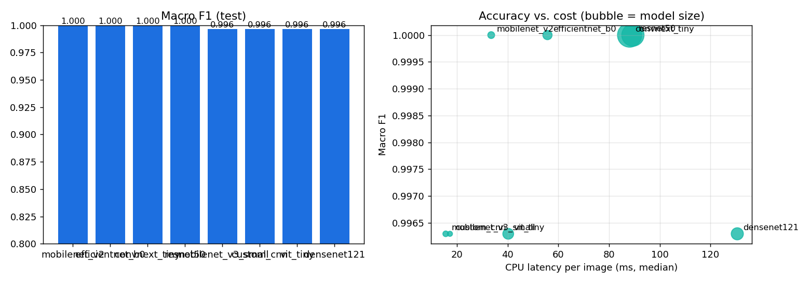

# Results

All numbers come from the held-out **test** splits described in [DATASETS.md](DATASETS.md):

- **NEU-CLS:** 270 images, 45 per class.
- **MVTec bottle:** 42 images.
- **MVTec metal_nut:** 59 images.

Every model was evaluated once on its test split; no model or threshold was tuned on it. Latencies are
CPU medians for a single image on the development laptop (no GPU). Regenerate the tables with
`python scripts/compare_models.py`. Per-run artefacts are in `artifacts/checkpoints/<run_id>/`:
`metrics.json`, `confusion_matrix.png`, `history.png` and `roc_pr.png`.

## 1. Tables

<!-- BEGIN GENERATED TABLES -->
### Classifiers - NEU-CLS held-out test split (identical for all models)

| Model | Pre-trained | Epochs | Accuracy | Macro P | Macro R | Macro F1 | ROC-AUC | Worst-class recall | ECE | CPU latency (ms) | Size (MB) | Train (min) |
|---|---|---|---|---|---|---|---|---|---|---|---|---|
| mobilenet_v2 | yes | 8 | 1.0000 | 1.0000 | 1.0000 | 1.0000 | 1.0000 | 1.000 | 0.001 | 33.5 | 8.9 | 11.9 |
| efficientnet_b0 | yes | 6 | 1.0000 | 1.0000 | 1.0000 | 1.0000 | 1.0000 | 1.000 | 0.000 | 55.7 | 16.1 | 13.1 |
| convnext_tiny | yes | 7 | 1.0000 | 1.0000 | 1.0000 | 1.0000 | 1.0000 | 1.000 | 0.000 | 88.1 | 111.3 | 30.3 |
| resnet50 | yes | 8 | 1.0000 | 1.0000 | 1.0000 | 1.0000 | 1.0000 | 1.000 | 0.000 | 89.4 | 94.1 | 4.8 |
| mobilenet_v3_small | yes | 8 | 0.9963 | 0.9964 | 0.9963 | 0.9963 | 1.0000 | 0.978 | 0.003 | 15.6 | 6.1 | 4.6 |
| custom_cnn | no (baseline) | 25 | 0.9963 | 0.9964 | 0.9963 | 0.9963 | 1.0000 | 0.978 | 0.006 | 17.3 | 4.9 | 22.4 |
| vit_tiny | yes | 5 | 0.9963 | 0.9964 | 0.9963 | 0.9963 | 1.0000 | 0.978 | 0.003 | 40.3 | 22.1 | 7.1 |
| densenet121 | yes | 5 | 0.9963 | 0.9964 | 0.9963 | 0.9963 | 1.0000 | 0.978 | 0.004 | 130.6 | 27.8 | 23.1 |

### Anomaly detectors - MVTec AD and KolektorSDD2 (commutator) test splits

The fusion rows describe the anomaly engines on their own. The decision actually deployed for each category (including validation-based engine selection and, for the commutator, classifier + segmentation voting) is measured end to end in `reports/end_to_end_evaluation.md`.

| Category | Engine | Image AUROC | Recall | FPR | Pixel AUROC | Dice | Latency (ms) |
|---|---|---|---|---|---|---|---|
| commutator | patchcore | 0.9500 | 0.991 | 0.673 | 0.9812 | 0.393 | 93 |
| commutator | padim | 0.9075 | 0.982 | 0.714 | 0.9706 | 0.423 | 90 |
| commutator | anomaly-engine fusion | auto-decided accuracy 0.398 | missed defects 0 | false rejects 151 | review rate 0.750 | | |
| bracket_black | patchcore | 0.8776 | 0.875 | 0.438 | 0.9761 | 0.131 | 76 |
| bracket_black | padim | 0.6224 | 0.708 | 0.750 | 0.9255 | 0.033 | 89 |
| bracket_black | anomaly-engine fusion | auto-decided accuracy 1.000 | missed defects 0 | false rejects 0 | review rate 0.675 | | |
| bracket_brown | patchcore | 0.9911 | 0.846 | 0.000 | 0.9886 | 0.309 | 74 |
| bracket_brown | padim | 0.7751 | 0.962 | 0.538 | 0.9410 | 0.157 | 92 |
| bracket_brown | anomaly-engine fusion | auto-decided accuracy 1.000 | missed defects 0 | false rejects 0 | review rate 0.282 | | |
| bracket_white | patchcore | 0.8375 | 0.875 | 0.667 | 0.9651 | 0.054 | 65 |
| bracket_white | padim | 0.7208 | 1.000 | 0.733 | 0.9483 | 0.031 | 86 |
| bracket_white | anomaly-engine fusion | auto-decided accuracy 0.786 | missed defects 0 | false rejects 3 | review rate 0.548 | | |
| connector | patchcore | 1.0000 | 1.000 | 0.000 | 0.9967 | 0.643 | 91 |
| connector | padim | 0.8571 | 1.000 | 0.333 | 0.9786 | 0.435 | 96 |
| connector | anomaly-engine fusion | auto-decided accuracy 1.000 | missed defects 0 | false rejects 0 | review rate 0.091 | | |
| metal_plate | patchcore | 1.0000 | 0.944 | 0.000 | 0.9806 | 0.812 | 66 |
| metal_plate | padim | 0.5556 | 0.944 | 1.000 | 0.9310 | 0.677 | 90 |
| metal_plate | anomaly-engine fusion | auto-decided accuracy 1.000 | missed defects 0 | false rejects 0 | review rate 0.204 | | |
| tubes | patchcore | 0.8464 | 0.914 | 0.688 | 0.9834 | 0.503 | 66 |
| tubes | padim | 0.5446 | 0.943 | 1.000 | 0.9345 | 0.194 | 90 |
| tubes | anomaly-engine fusion | auto-decided accuracy 1.000 | missed defects 0 | false rejects 0 | review rate 0.529 | | |
| bottle | patchcore | 1.0000 | 0.969 | 0.000 | 0.9824 | 0.644 | 337 |
| bottle | padim | 0.9938 | 1.000 | 0.100 | 0.9851 | 0.692 | 189 |
| bottle | anomaly-engine fusion | auto-decided accuracy 1.000 | missed defects 0 | false rejects 0 | review rate 0.071 | | |
| grid | patchcore | 0.9636 | 0.967 | 0.273 | 0.9622 | 0.365 | 89 |
| grid | padim | 0.9212 | 0.900 | 0.636 | 0.9095 | 0.322 | 113 |
| grid | anomaly-engine fusion | auto-decided accuracy 0.962 | missed defects 0 | false rejects 1 | review rate 0.366 | | |
| metal_nut | patchcore | 1.0000 | 0.979 | 0.000 | 0.9826 | 0.692 | 84 |
| metal_nut | padim | 0.9867 | 0.979 | 0.000 | 0.9759 | 0.652 | 97 |
| metal_nut | anomaly-engine fusion | auto-decided accuracy 1.000 | missed defects 0 | false rejects 0 | review rate 0.203 | | |
| screw | patchcore | 0.9820 | 1.000 | 0.429 | 0.9891 | 0.288 | 135 |
| screw | padim | 0.7869 | 0.984 | 0.762 | 0.9776 | 0.250 | 140 |
| screw | anomaly-engine fusion (superseded: all engines voting) | auto-decided accuracy 1.000 | missed defects 0 | false rejects 0 | review rate 0.439 | | |
<!-- END GENERATED TABLES -->

*Notes on the table:*
- *ResNet-50's training time counts only its final epoch: the host ran low on memory at epoch 8 and the run was
  resumed from `last.pt`.*
- *Epoch counts below 8 mean early stopping (patience 3).*
- *The latency column was measured at the end of each training run, sometimes while another job was using the
  CPU. The idle-machine figures are in §7.*

## 2. Classification (NEU-CLS)

**Accuracy.** Eight classifiers were trained with the same pipeline and evaluated once on the same 270 test images.

| Group | Models | Test accuracy | Errors |
|---|---|---|---|
| Pre-trained, perfect | MobileNetV2, EfficientNet-B0, ResNet-50, ConvNeXt-Tiny | 100 % | none |
| Pre-trained, one error | MobileNetV3-Small, ViT-Tiny, DenseNet-121 | 99.6 % | one `scratches` image predicted as `inclusion` |
| Baseline (from scratch) | custom CNN | 99.6 % | one `pitted_surface` image predicted as `rolled-in_scale` |

The three pre-trained models with an error each miss a *different* scratches image (`scratches_95`, `_122`,
`_149`). The errors therefore come from the individual models, not from a single mislabelled test item.

**Calibration.** Calibrated confidence is well calibrated for every model: the ECE is 0.006 or less.

**Convergence.** The pre-trained models reached their best validation loss within 5–8 epochs. The baseline
needed 25 epochs and its validation curve is noisier (see `history.png`).

**Interpretation.**
- NEU-CLS is a clean, balanced and well-separated benchmark, so accuracy saturates. Single-image differences
  (1/270 = 0.37 %) are within run-to-run noise, and the results should not be read as a ranking of
  architectures.
- The proposal's transfer-learning hypothesis is supported mainly by faster and more stable convergence.
- On real line images we expect lower scores and larger differences, so the comparison must be repeated on the
  target line's data.

## 3. Model selection (proposal objective 6)

Because accuracy is tied, the choice rests on cost, robustness and deployability (latencies from §7):

| Role | Model | Why |
|---|---|---|
| **Primary** | MobileNetV2 | 100 % on the test split; 31 ms per image and 8.7 MB. It also quantises to INT8 without any accuracy loss (§8), so the same model can run on an edge device |
| **Ensemble partner** | EfficientNet-B0 | 100 %, with a different architecture family. Averaging the calibrated probabilities and sending disagreements to review adds a safety check for about 41 ms more |
| Evaluated, not selected | ConvNeXt-Tiny, ResNet-50 | 100 %, but 65–95 ms per image and 90–106 MB, with no accuracy to gain on this data |
| Evaluated, not selected | DenseNet-121, ViT-Tiny | One test error each; DenseNet is also the slowest model (116 ms) |
| Edge FP32 only | MobileNetV3-Small | The fastest pre-trained model (16 ms, 218 img/s at batch 16). It loses its accuracy under INT8 quantisation (§8), so it is only an option in FP32 |
| Baseline | Custom CNN | 13 ms, but trained from scratch with a slower and noisier convergence |

The deployed `steel_strip` profile uses the MobileNetV2 + EfficientNet-B0 ensemble. Any member disagreement, low
calibrated confidence or out-of-distribution score routes the item to manual review.

## 4. Anomaly detection (MVTec AD)

- **PatchCore** reaches an image AUROC of **1.000** on both categories and a pixel AUROC of about **0.98**, so it localises the defective region well.
- **Misses at the image threshold:** PatchCore missed one `contamination` bottle (10/11 detected) and one `scratch` metal nut (11/12). It flagged none of the 21 good test items.
- **PaDiM** is slightly weaker (AUROC 0.99) but faster, and it fails on different images. Requiring the two engines to agree, plus a ±8 % review margin around each threshold, gives the deployed decision rule:
  - **bottle:** every automatically decided item was correct (0 missed defects, 0 false rejects); 7 % of items went to review.
  - **metal_nut:** the same, with 20 % of items going to review.

  Borderline items are the ones routed to review, so no item is accepted or rejected silently.
- **Unfamiliar inputs:** for each category, the global novelty check flags **100 %** of 60 foreign images (other MVTec categories and NEU steel) and none of the in-distribution test images.

## 5. Explainability

- **Grad-CAM** on NEU-CLS concentrates on the defect itself, for example along the scratch line in `docs/assets/steel_gradcam.png`.
- **Anomaly maps** outline broken or contaminated regions on bottles and metal nuts (`docs/assets/bottle_localisation.png`).
- **Visible model mistakes:** when an image of the wrong product type is inspected, Grad-CAM attention is diffuse and the image is flagged as unfamiliar, so the explanation itself shows that the model is out of its depth.

## 6. End-to-end system

| Check | Result |
|---|---|
| Automated tests (`pytest`) | 64 passed. 60 are unit, API, workflow, migration and integration tests with real models; 4 are Playwright browser tests |
| Browser tests (Playwright, real server, headless Chrome) | landing and login; all 16 app pages render with no JavaScript errors; upload → inspection → PDF → XAI lab; fake-camera capture |
| CI simulation (only git-tracked files: no datasets, no weights) | passes, with the asset-dependent tests skipped |
| Production-line simulation: 25 bottles plus 15 metal nuts, 40 % defect injection | bottle: 7 PASS, 14 FAIL, 4 REVIEW. Across the 31 auto-decided items with ground truth: false-negative rate 0 %, false-positive rate 0 % |
| Inference latency, full pipeline, idle CPU (§7) | about 0.24 s per bottle or metal-nut image; 0.10 s per steel image (0.43 s with Grad-CAM) |

## 7. Measured performance (idle machine)

Generated by `python scripts/benchmark.py` on 2026-11-05 (Intel Core, 12 logical CPUs, 15.7 GB RAM, PyTorch 2.8
CPU, no GPU). The full output, including p95 values and memory, is in `artifacts/metrics/benchmark.md` and
`benchmark.json`.

| Model | Params (M) | Load (ms) | Median latency, 1 image (ms) | Throughput @16 (img/s) |
|---|---|---|---|---|
| custom_cnn | 1.2 | 26 | 12.7 | 105 |
| mobilenet_v3_small | 1.5 | 85 | 15.6 | 218 |
| mobilenet_v2 | 2.2 | 74 | 31.5 | 50 |
| vit_tiny | 5.5 | 675 | 37.2 | 56 |
| efficientnet_b0 | 4.0 | 115 | 41.5 | 42 |
| convnext_tiny | 27.8 | 323 | 65.2 | 22 |
| resnet50 | 23.5 | 343 | 95.2 | 15 |
| densenet121 | 7.0 | 198 | 116.4 | 16 |

**Anomaly scoring:** 34–44 ms (PatchCore) and 53–54 ms (PaDiM) per image. Model load takes 0.16–0.24 s.

**Full pipeline per image** (validation, models, rules and visualisations; medians):

| Profile | Without explanation maps | With explanation maps |
|---|---|---|
| Bottle | 243 ms | 239 ms |
| Metal nut | 226 ms | 230 ms |
| Steel (2-model ensemble) | 101 ms | 427 ms (Grad-CAM) |

Peak process memory with every model loaded was 2.0 GB. The memory column in `benchmark.md` is the RSS growth
when a model loads. Python reuses freed memory, so small models can show 0 there; treat that column as a lower
bound.

## 8. Edge export: ONNX and INT8 (research direction: lightweight edge AI)

`python scripts/export_onnx.py` exports each model to ONNX (opset 17), then applies INT8 static quantisation
(QDQ, per-channel weights). Quantisation is calibrated on 100 *validation* images; every variant is evaluated on
the 270 test images. Latency is measured on 1 CPU thread, as on a small edge device.

| Model | Variant | Test accuracy | Agreement with PyTorch | Latency (ms) | Size (MB) |
|---|---|---|---|---|---|
| MobileNetV2 | PyTorch FP32 | 1.0000 | — | 16.9 | 8.7 |
| MobileNetV2 | ONNX FP32 | 1.0000 | 100 % | 7.7 | 8.5 |
| MobileNetV2 | **ONNX INT8** | **1.0000** | **100 %** | **4.6** | **2.5** |
| MobileNetV3-Small | PyTorch FP32 | 0.9963 | — | 5.4 | 5.9 |
| MobileNetV3-Small | ONNX FP32 | 0.9963 | 100 % | 2.4 | 5.8 |
| MobileNetV3-Small | ONNX INT8 | 0.3407 | 34 % | 2.7 | 1.8 |

- **MobileNetV2 quantises cleanly.** INT8 makes it 3.7× faster than PyTorch and 3.5× smaller with no change in
  any prediction.
- **MobileNetV3-Small collapses under the same procedure.** This is a known weakness of its hard-swish
  activations and squeeze-excite blocks under post-training quantisation; recovering it would need
  quantisation-aware training.
- **ONNX FP32 is exact for both models** and about 2× faster than eager PyTorch.
- **The calibration-method option had no effect.** onnxruntime 1.26 produced byte-identical models for MinMax
  and Entropy calibration, so only MinMax is reported.

## 9. Custom products trained from 30 good photos (Add a product)

To check the *Add a product* workflow end to end, two products were created from only **30 good training photos**
each (no defect labels), using the protocol in [QUALITY_RULES.md](QUALITY_RULES.md#custom-products-add-a-product).
They were then evaluated on the full held-out MVTec test split. The protocol defaults were tuned on the
*validation* split, never on these test images.

| Product | Good test items | Defective test items |
|---|---|---|
| Bottle | 10 PASS, 0 REVIEW, 0 FAIL | 31 FAIL, 1 REVIEW, **0 missed** |
| Metal nut | 10 PASS, 1 REVIEW, 0 FAIL | 41 FAIL, 6 REVIEW, **1 missed** (a faint scratch, score 0.91× threshold) |

Images of other products sent to these models were reported as *unfamiliar* (INCONCLUSIVE) rather than judged.
Training took about 2.5–3 minutes per product on the CPU.

**Earlier protocol and why it changed.** A first protocol used one held-back calibration split and a tight
novelty threshold. With 30 photos, it labelled 28 of 32 defective bottles *unfamiliar* and sent 7 of 10 good
bottles to review. With PaDiM as an equal voter, it also passed a scratched metal nut. The measurements behind
the redesign are in [DEVELOPMENT_LOG.md](DEVELOPMENT_LOG.md).

**Caveat.** MVTec photos are taken under controlled conditions. Real photos taken with a phone, with changing
backgrounds or lighting, will need more good examples (30–100+) and consistent camera placement.

## 10. Extension (2026-11-05): more categories, component recognition, supervised segmentation, end-to-end verdicts

All numbers below come from held-out **test** splits that were never used for training, threshold selection or
policy choice. Hardware: CPU only (12 logical cores, 16 GB RAM, no GPU).

### 10.1 New anomaly categories (MVTec AD screw, grid; KolektorSDD2 commutator)

See the generated table in §1. In short (test image AUROC / pixel AUROC):
screw PatchCore 0.982 / 0.989 (PaDiM 0.787); grid PatchCore 0.964 / 0.962 (PaDiM 0.921);
commutator PatchCore 0.950 / 0.981 (PaDiM 0.908).

**Validation-based engine selection.** An engine votes only if its *validation* image AUROC is ≥ 0.90.
Screw PaDiM (val 0.803) therefore does not vote; all other engines do. The rule uses validation data only.
For the commutator, PatchCore at its validation recall-95 threshold over-flags normal surfaces (151 of 894 test normals),
so on this surface it is used only for its heat-map (see 10.4).

### 10.2 KolektorSDD2 supervised classifiers (binary good / defect, 224 px)

| Model | Test accuracy | Macro F1 | ROC-AUC | Defect recall | Defect precision | Normal recall | ECE |
|---|---|---|---|---|---|---|---|
| EfficientNet-B0 | 0.964 | 0.910 | 0.959 | 0.864 | 0.819 | 0.977 | 0.030 |
| MobileNetV2 | 0.959 | 0.901 | 0.952 | 0.873 | 0.780 | 0.970 | 0.014 |

Test split: official KSDD2 test, 1,004 images (110 defective). Both ran the full 10 epochs.
Resizing the ≈230×630 images to 224×224 squashes thin defects; the segmentation model below uses a 384×128 input instead.

### 10.3 Supervised defect segmentation (U-Net, ResNet-18 encoder, KolektorSDD2 pixel masks)

| Image AUROC | Image AP | Defect recall | False-positive rate | Pixel AUROC | Mean Dice (defective) | Mean IoU | CPU latency |
|---|---|---|---|---|---|---|---|
| 0.972 | 0.912 | 0.845 (93/110) | 0.017 (15/894) | 0.945 | 0.640 | 0.520 | 202 ms |

Epoch selected by 0.5 × val Dice + 0.5 × val image AUROC; image threshold chosen on val (best F1).
**Training was stopped by the operator after 7 of 14 planned epochs to save time**; epoch 7 was the best
validation epoch so far (val Dice 0.677, val image AUROC 0.986). The test set was evaluated once, afterwards
(`scripts/train_segmentation.py --finalize-only`). More epochs may improve the model.

### 10.4 Commutator decision policy (chosen on the validation split)

Pre-declared criterion: fewest defects auto-passed as NORMAL, then lowest manual-inspection rate.
Validation split: 350 images (37 defective).

| Voting engines | Defects auto-passed | False alarms | Manual rate |
|---|---|---|---|
| segmentation only | 5 | 2 | 8.0 % |
| **classifier ensemble + segmentation (deployed)** | **4** | **0** | **9.1 %** |
| classifier + anomaly + segmentation | 0 | 0 | 93.7 % |

This comparison also exposed a fusion bug (non-voting engines still influenced the outcome) and an unsuitable
relative review margin for saturated U-Net probabilities; both were fixed before the comparison above was run.

### 10.5 Component recognition (automatic category routing and unsupported-image rejection)

Logistic regression on frozen ImageNet ResNet-18 embeddings, plus a per-category k-NN distance limit calibrated on
held-out in-category images. Six categories: steel strip, bottle, metal nut, screw, metal grid, commutator.

| Held-out test images | Correct category | Supported images wrongly rejected | Accepted with wrong category |
|---|---|---|---|
| 1,498 | 100 % | 1.1 % (worst: metal grid 3/41) | 0 |

| Unsupported probe set (evaluation only) | Images | Rejected |
|---|---|---|
| Imagenette natural photos | 300 | 100 % |
| MVTec AD categories not supported (hazelnut, carpet, wood, toothbrush, pill, cable) | 120 | 100 % |

These probe sets measure rejection for these kinds of images only; other unsupported images may behave differently.

### 10.6 End-to-end verdicts (deployed system, auto-recognition, held-out test)

Generated by `scripts/evaluate_profiles.py` → `reports/end_to_end_evaluation.md`. Each image goes through exactly
the `/api/inspect` path.

| Category | Test images (defective / normal) | Routed correctly | Manual rate | Auto-decided accuracy | Defects auto-passed | False alarms | p50 latency |
|---|---|---|---|---|---|---|---|
| bottle | 42 (32/10) | 100 % | 7.1 % | 100 % | 0 | 0 | 438 ms |
| commutator surface | 1,004 (110/894) | 100 % | 7.9 % | 98.8 % | **10** | 1 | 433 ms |
| metal grid | 41 (30/11) | 100 % | 41.5 % | 100 % | 0 | 0 | 356 ms |
| metal nut | 59 (48/11) | 100 % | 22.0 % | 100 % | 0 | 0 | 332 ms |
| screw | 82 (61/21) | 100 % | 42.7 % | 100 % | 0 | 0 | 257 ms |
| steel strip | 270 (270/0) | 100 % | 0.7 % | 100 % | 0 | 0 | 168 ms |
| unsupported photos / objects | 420 | → MANUAL 100 % | | | | | |

**Reading this honestly:**
- The commutator surface is the hardest category: **10 of 110 defective test commutators (9 %) were auto-passed as NORMAL.**
  Do not use it without human sampling; a lower segmentation threshold (chosen on validation) would trade more
  manual inspections for fewer misses.
- Screw and grid never auto-pass a defect on test, but send every normal part to manual inspection. The validated
  recall-95 thresholds place normal scores just below the threshold, inside the ±8 % review margin. Narrowing the
  margin is a per-category validation decision, not yet made.
- Steel strip (NEU-CLS) has no defect-free class: the system identifies *which* defect is present and cannot certify
  a steel surface as normal.

### 10.7 Image-quality (blur) check

Normalised sharpness (Laplacian variance at 256 px short side); limit = 0.5 × 1st percentile of train + val images.
On held-out test images: 0 % genuine images rejected in every category. Gaussian-blurred test copies detected:
σ = 4: 100 % in all categories; σ = 2: 100 % except steel strip (36 %, some NEU surfaces are naturally very smooth).
An earlier train-only calibration rejected 13.6 % of genuine metal-nut test images (flipped nuts are smooth), so the
calibration set was changed to train + val. Details: `artifacts/metrics/image_quality_calibration.json`.

### 10.8 MPDD metal parts (added on request: more public datasets)

Six categories from MPDD (Metal Parts Defect Detection): parts photographed at varied positions, orientations and
backgrounds. PatchCore + PaDiM, same protocol as MVTec (train = defect-free, val = calibration, test = held out).
PaDiM fell below the validation AUROC rule in all six, so **PatchCore alone decides**. For black bracket, no engine
reached 0.90 on validation, so the best one (PatchCore, 0.835) is used.

| Category | PatchCore test image AUROC | Pixel AUROC | End-to-end manual rate | Defects auto-passed | False alarms |
|---|---|---|---|---|---|
| bracket_black | 0.878 | 0.976 | 70.0 % | 0 | 0 |
| bracket_brown | 0.991 | 0.989 | 30.8 % | 0 | 0 |
| bracket_white | 0.838 | 0.965 | 54.8 % | 0 | 3 |
| connector | 1.000 | 0.997 | 13.6 % | 0 | 0 |
| metal_plate | 1.000 | 0.981 | 20.4 % | 0 | 0 |
| tubes | 0.846 | 0.983 | 54.9 % | 0 | 0 |

The component recogniser was retrained with all 12 categories: 100 % correct category on 1,730 held-out test images,
1.5 % of supported images wrongly rejected, 0 accepted with the wrong category, and 100 % of the 420 unsupported probe
images rejected. Test sets are small (22–51 images per MPDD category), so these rates have wide uncertainty.

**Limitation:** studio or web photos (for example, a side-view bolt on a white background) still differ strongly from every
training set and are reported as MANUAL INSPECTION REQUIRED. Reliable verdicts on such photos need training images taken
the same way (main app → Products → Add a product).
